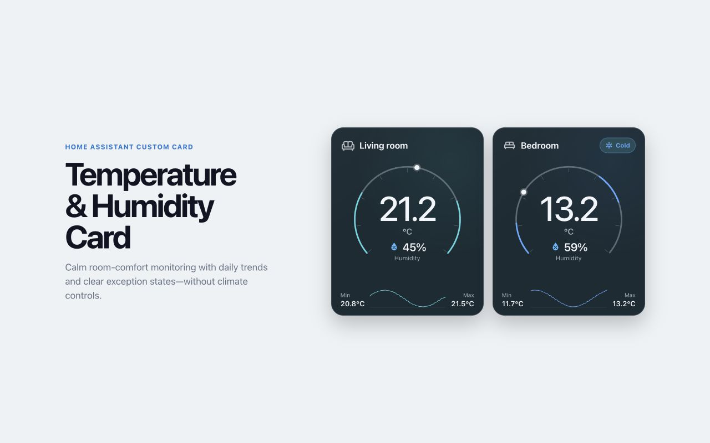

# Temperature & Humidity Card for Home Assistant

[](https://github.com/halfbuilthq/temperature-humidity-card/actions/workflows/ci.yml)
[](https://github.com/halfbuilthq/temperature-humidity-card/actions/workflows/hacs.yml)
[](https://github.com/halfbuilthq/temperature-humidity-card/releases)

A sensor-only room-comfort card for Home Assistant dashboards. It combines
temperature, humidity, comfort exceptions, a 24-hour range, and a compact
trend without exposing thermostat or air-conditioning controls.



## Features

- Temperature and humidity from ordinary sensor entities
- Clear Cold, Warm, Dry, Humid, mixed and unavailable states
- Configurable comfort thresholds
- Temperature history with minimum, maximum and sparkline
- Mouse, touch and keyboard chart inspection with temperature and humidity tooltips
- Optional sensor battery warning that stays hidden while healthy
- Native Home Assistant visual configuration
- Responsive sizing for grids and room views
- Keyboard-accessible entity detail actions
- HACS-compatible packaging

## Configuration

```yaml
type: custom:temperature-humidity-card
title: Kitchen
icon: mdi:silverware-fork-knife
temperature_entity: sensor.kitchen_temperature
humidity_entity: sensor.kitchen_humidity
battery_entity: sensor.kitchen_sensor_battery
history_hours: 24
show_history: true
cold_threshold: 16
warm_threshold: 26
dry_threshold: 35
humid_threshold: 65
low_battery_threshold: 25
```

Only `temperature_entity` and `humidity_entity` are required. The card never
requires or controls a `climate` entity. Battery state is displayed only when
it is at or below `low_battery_threshold`.

### Minimal configuration

```yaml
type: custom:temperature-humidity-card
temperature_entity: sensor.room_temperature
humidity_entity: sensor.room_humidity
```

### Entity requirements

- `temperature_entity`: a sensor with a numeric temperature state and a
  temperature unit such as `°C` or `°F`.
- `humidity_entity`: a sensor with a numeric relative-humidity state in `%`.
- `battery_entity`: an optional numeric battery sensor in `%`.

The temperature and humidity sensors do not need to come from the same device.

### Dashboard sizing

In a Sections dashboard, the card defaults to the full 12-column section and
supports resizing down to 6 columns in the Layout tab. For two cards side by
side, set each card to 6 columns:

```yaml
grid_options:
  columns: 6
  rows: auto
```

The gauge and readings scale with the available card width. At compact widths,
the history graph appears above the minimum and maximum readings. Keep rows
set to `auto` so the card can grow when labels wrap. No custom scaling setting
is needed.

## Installation with HACS

Until this repository is accepted into the default HACS catalogue, add it as a
custom repository:

1. Open HACS in Home Assistant.
2. Open the three-dot menu and choose **Custom repositories**.
3. Add this repository URL and select **Dashboard** as the category.
4. Install **Temperature & Humidity Card**.
5. Refresh the browser after installation.

Add the card through Home Assistant's card picker or use the YAML examples
above. The card includes a native visual configuration form.

## Development

```sh
npm install
npm run dev
```

Run all tests and build the production bundle:

```sh
npm run check
```

The bundle is emitted to `dist/temperature-humidity-card.js`.

See [CONTRIBUTING.md](CONTRIBUTING.md) for contribution and release guidance.

## Manual installation

1. Copy `dist/temperature-humidity-card.js` to
   `<config>/www/temperature-humidity-card.js`.
2. Add `/local/temperature-humidity-card.js` as a JavaScript module dashboard
   resource.
3. Add **Temperature & Humidity Card** from Home Assistant's card picker.

## License

[MIT](LICENSE)
