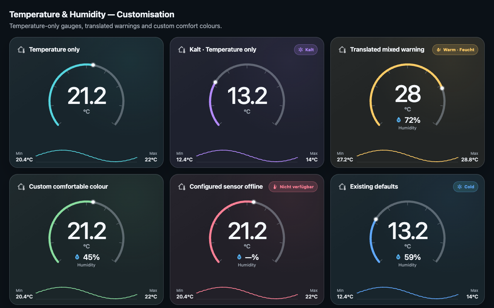
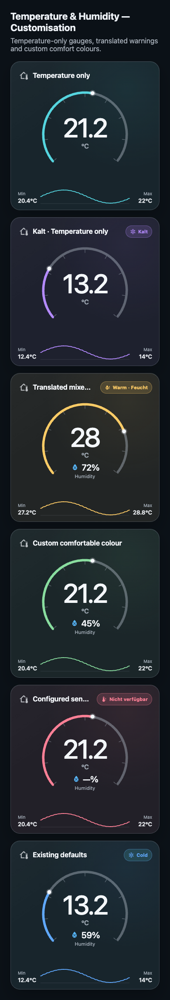

# Issue #6 customisation checks

Verified on 21 October 2026 using the local demo and an isolated Chrome session.

- `npm run check`: 22 tests passed; TypeScript and production build passed.
- Temperature-only cards omit humidity readings, tooltip rows and accessibility descriptions.
- Temperature history requests exclude an omitted or empty humidity entity.
- Configured humidity sensors that are unavailable retain the Unavailable state.
- Custom warning text works for individual and combined warnings; empty overrides restore defaults.
- Custom accents were checked in comfortable, cold, mixed and unavailable states.
- Clearing a custom colour restores the original state colour on the same card.
- Keyboard chart inspection works with and without humidity.
- Live configuration changes correctly add/remove the humidity display and hide history.
- Gauge, readings, warnings and range labels fit card widths of 200, 240 and 320 pixels.
- Desktop (1280 × 800) and mobile (390 pixels wide) previews were visually inspected.
- No browser runtime errors occurred during these checks.

The preview uses simulated Home Assistant sensor/history data. The native editor
schema is covered by automated checks; this change has not been installed on a
live Home Assistant instance.

Run `npm run dev` and open `/demo/customization.html` to inspect the six examples.

