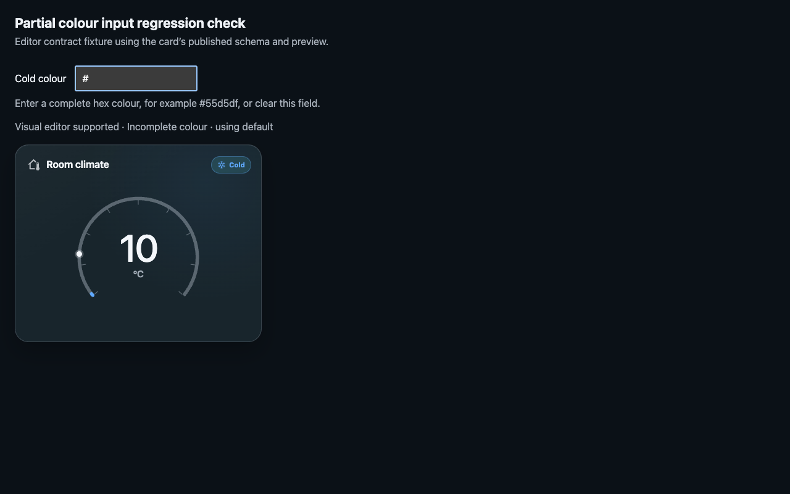

# Partial editor input regression checks

Verified on 21 October 2026 for issue #7 and release v0.2.1.

## Scope and cause

The shared configuration validator previously disabled the native visual editor
on intermediate edits. Colour fragments, an empty required entity and temporary
numeric range errors all reached `assertConfig` and threw an exception.

The editor now checks supported field types; the card separately validates the
configuration it needs to render. Only complete hex colours reach card styles.
The editor retains the original input and provides a colour-format hint.

## Verification

- `npm run check`: all 33 tests pass, including TypeScript and production build.
- Every colour field is exercised through typing and reverse deletion of
  `#55d5df`, invalid text, whitespace, and complete short/long hex values.
- Entity fields accept cleared and partial selections in the editor assertion.
- All six numeric fields accept cleared and temporarily out-of-range edits;
  required entity, history-period and threshold-order runtime checks still fail
  invalid configurations as expected.
- Title, icon, all five warning labels and the history toggle are checked.
- Objects/arrays in text fields, invalid numeric types, non-finite numbers and
  invalid toggle types remain rejected.
- Colour format patterns accept whitespace and valid hex values and are not
  accidentally applied to warning-label fields.
- An isolated Chrome session exercised the compiled release bundle through 126
  colour transitions across all seven comfort states. Incomplete/invalid values
  used the expected default accent and raw input was retained.
- A native text-input fixture using the exported selector pattern accepted
  character-by-character input, retained `#`, reported the format error, and
  continued updating the real card. No browser runtime errors occurred.

The browser fixture exercises the published editor callbacks and rendered card;
it is not a live Home Assistant editor session. Home Assistant's documented
[`assertConfig` contract](https://developers.home-assistant.io/docs/frontend/custom-ui/custom-card/)
defines assertion errors as disabling the visual editor. Its
[number selector](https://github.com/home-assistant/frontend/blob/dev/src/components/ha-selector/ha-selector-number.ts)
emits `undefined` for empty/incomplete numeric input, which the regression tests cover.

