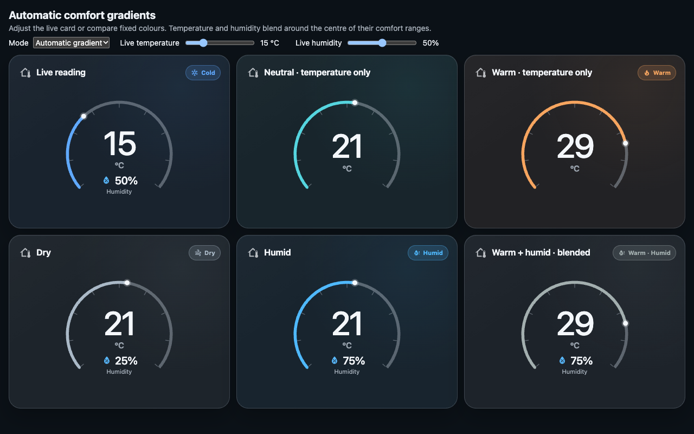
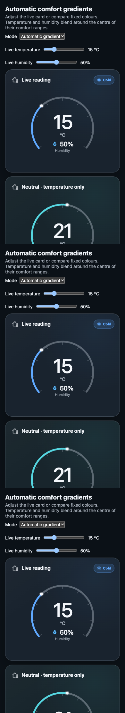

# Automatic gradient verification

Verified on 21 October 2026 for issue #8 and release v0.3.0.

## Behaviour

`color_mode: state` remains the default. `color_mode: gradient` interpolates
Cold → Comfortable → Warm and Dry → Comfortable → Humid using the existing
thresholds and custom colour anchors. Each axis is neutral at its range midpoint
and saturated at/beyond its threshold endpoints. With both sensors configured,
normalised distances weight the blend. Unavailable states retain their existing
custom colour or Home Assistant error-colour fallback. Labels are unchanged.

## Checks

- `npm run check`: all 42 tests, TypeScript and production build passed.
- Numeric tests cover endpoints, midpoints, intermediate values, extremes,
  combined readings, custom thresholds including Fahrenheit values, short hex,
  partial edits, missing sensors and default fixed-mode behaviour.
- Continuity is checked across neutral points, state thresholds and the boundary
  where combined endpoint weights are normalised.
- The compiled bundle was exercised in an isolated Chrome session: live sensor
  changes, fixed/gradient switching, unavailable state and a custom theme error
  colour, temperature-only cards, partial anchors and mobile fit passed.
- The previous 126-transition partial-input browser check also passed against
  the new bundle with no runtime errors.
- Desktop (1280 × 800) and mobile (390 pixels wide) screenshots were visually
  inspected. Tests use simulated sensor data, rather than a live HA installation.

Run `npm run dev` and open `/demo/gradient.html` to explore the readings with
temperature/humidity sliders and compare fixed versus automatic colours.

