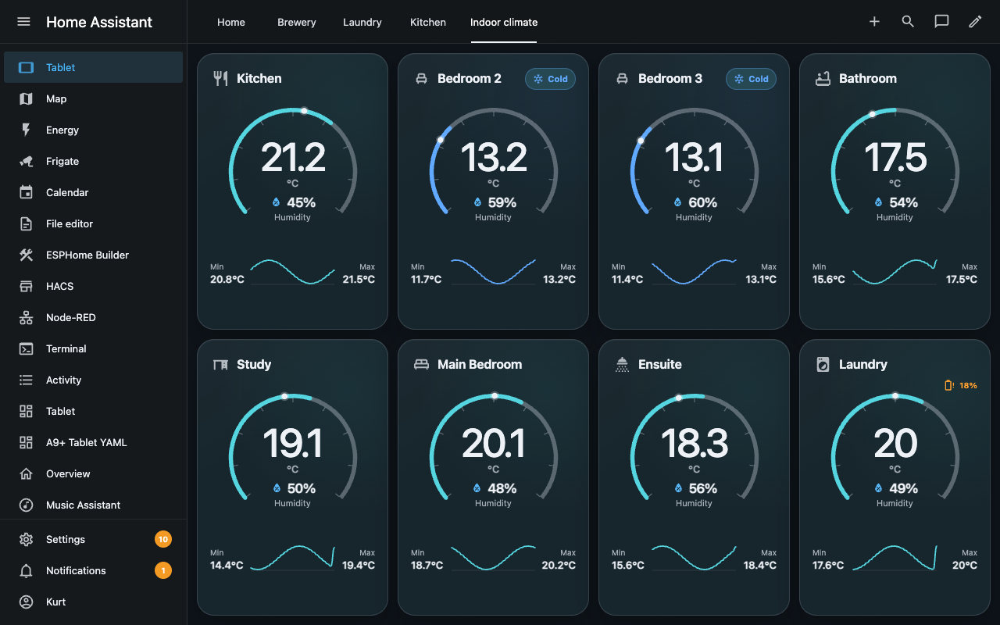
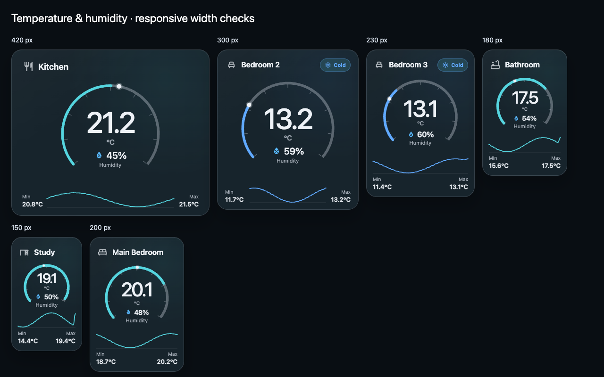

# Responsive sizing verification

Issue: [#5](https://github.com/halfbuilthq/temperature-humidity-card/issues/5)

The previous fixed-width gauge and minimum history-column widths overflowed
compact cards. At 180 px, the history row extended to 188 px and the gauge to
220 px from the left card edge; the card's overflow clipping hid the content.

The updated layout uses a proportional gauge and readings, a shrinkable grid
column, and a two-row history layout at widths up to 230 px. Compact tooltips
are centred over the graph, and their text can wrap.

## Browser checks

Verified in headless Google Chrome against the local demo:

- Widths: 150, 160, 180, 200, 230, 231, 250, 300, 419, 420, and 600 px.
- States: normal readings; long title with negative temperature, high humidity
  and low battery; unavailable sensors; three-digit Fahrenheit temperature;
  and hidden history with low battery.
- All 55 combinations kept the measured gauge, header, readings, history, and
  range values inside the card, without readings overlapping history.
- Keyboard inspection at the first, middle, and last history points kept
  tooltips inside the card. Escape dismissed each tooltip.
- Sections sizing now advertises 12 default columns, 6 minimum columns, and
  automatic rows. Existing explicit dashboard sizing remains user-controlled.

These checks use mocked Home Assistant entities and history. The actual Home
Assistant Layout editor has not been exercised in this verification.

## Screenshots

Standard dashboard at 1280 × 800:

Width comparison at 1280 × 800:

