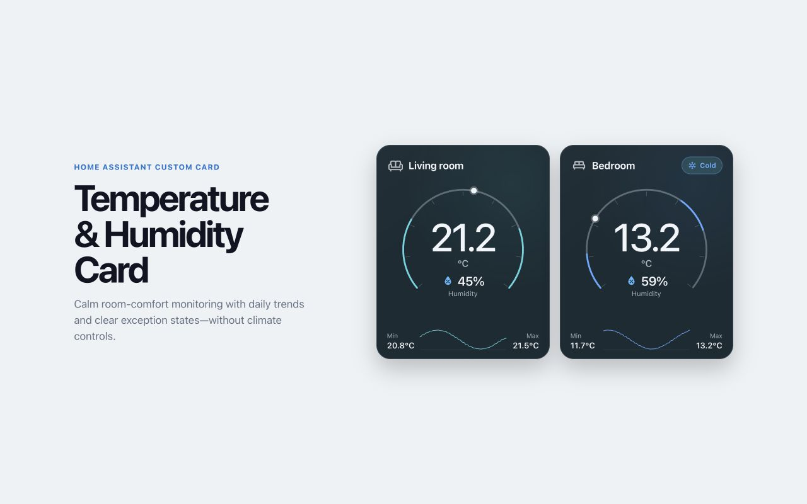

# Temperature & Humidity Card

A sensor-only Home Assistant card for room temperature, optional humidity, comfort
exceptions, and 24-hour trends. Available directly in the HACS catalogue. It intentionally provides no thermostat or
air-conditioning controls.



## Highlights

- Works with ordinary temperature sensors, with optional humidity.
- Supports custom warning text and comfort-state colours.
- Shows Cold, Warm, Dry, Humid, mixed, and unavailable exceptions.
- Displays the 24-hour minimum, maximum, and temperature trend.
- Supports an optional battery sensor while hiding healthy battery states.
- Includes Home Assistant's native visual card configuration form.

## Minimal configuration

```yaml
type: custom:temperature-humidity-card
temperature_entity: sensor.room_temperature
humidity_entity: sensor.room_humidity
```

Omit `humidity_entity` for a temperature-only gauge. See the repository README
for the complete configuration, warning text, colour and threshold options.
